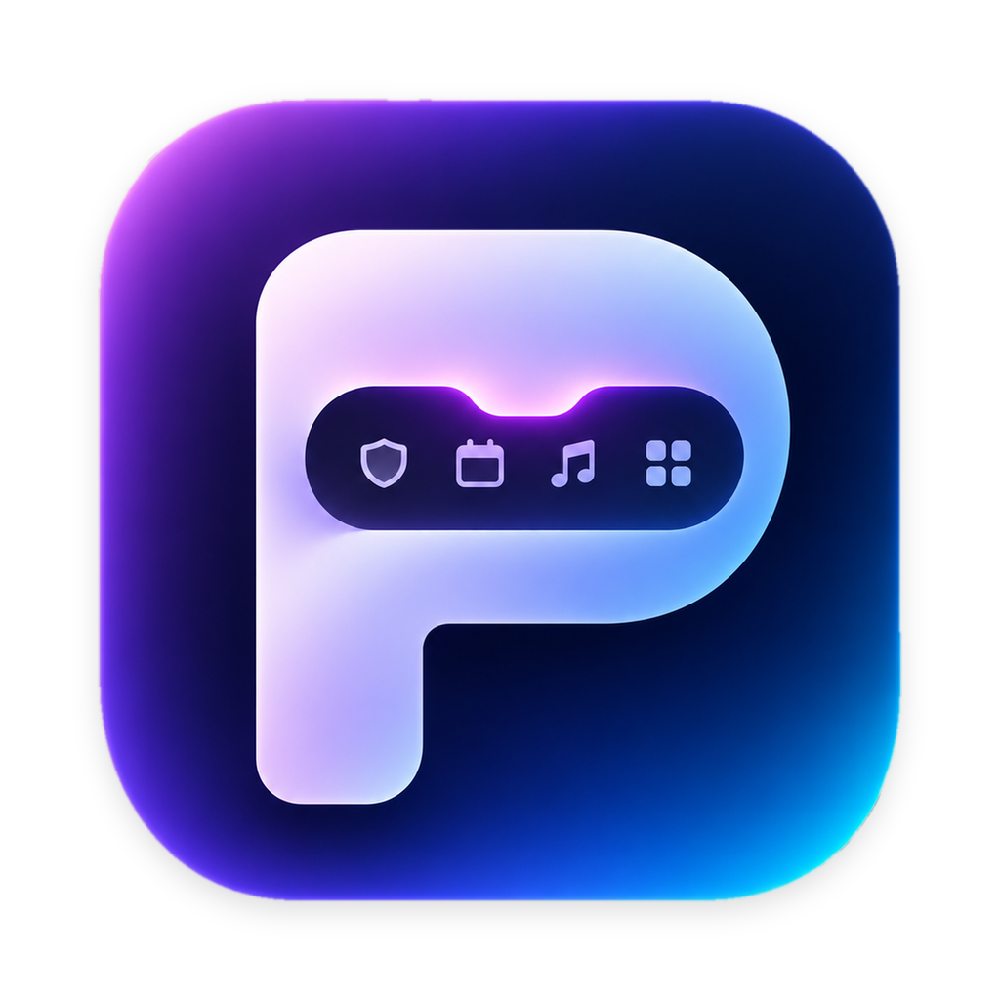

<p align="center">
  
</p>

<h1 align="center">Polka</h1>

<p align="center">
  A control center that lives in your MacBook’s notch.<br>
  Saved tabs, VPN, music, your next meeting, a calculator and a clipboard — one hover away.
</p>

<p align="center">
  <a href="https://github.com/romabmstu/polka/releases/latest"></a>
  <a href="https://github.com/romabmstu/polka/actions/workflows/ci.yml"></a>
  
  <a href="LICENSE"></a>
</p>

<p align="center"><a href="README.ru.md">Читать по-русски</a> · <a href="https://romabmstu.github.io/polka/">Website</a></p>

---

Point at the notch and it opens into a panel. Move away and it tucks back in. On displays without a notch Polka sits at the top center as a small capsule, and by default it follows the pointer to whichever display you are using.

While closed, the notch shows what matters right now: a shield when your VPN is on and a countdown when a meeting is about to start.

## What it does

**Tabs.** Keep pages in named, colored groups instead of a hundred open tabs. Save the current Safari tab with one click or <kbd>⌥⇧S</kbd>, drag links from anywhere onto a group, paste a whole list (plain links, Markdown or a OneTab export). Sort by title, site, date or recent use, search across everything, open a group in the current or a new window.

**VPN.** Every VPN registered in System Settings — WireGuard, Happ, V2Box, corporate L2TP and others — with a switch. Turning one on turns the others off.

**Music.** Title, artist, artwork and a seekable progress bar for whatever is playing — Yandex Music, Music, Spotify, a video in the browser — and which app that is, so play and pause always act where you expect.

**Calendar.** Today’s events from the calendars already on your Mac (Google, iCloud, Exchange) and a Join button for Google Meet, Zoom, Teams, Telemost, Jitsi and Webex links.

**Calculator and currencies.** Type `1250 × 1.2 + 15%`, get the answer. Convert between your favorite currencies.

**Clipboard.** The last 30 things you copied. Passwords are never recorded.

**Shelf.** Drop files into the notch and drag them out later, or send them over AirDrop.

**Scenarios.** One click for several things at once — for example *Work*: connect the VPN, open the work tabs, start music.

## Install

1. Download `Polka-vX.Y.Z.zip` from [Releases](https://github.com/romabmstu/polka/releases/latest) and move **Polka** to Applications.
2. The app is not notarized by Apple yet, so the first launch is blocked. Run once in Terminal:
   ```sh
   xattr -dr com.apple.quarantine /Applications/Polka.app
   ```
   or open it, then go to System Settings › Privacy & Security and click **Open Anyway**.
3. Point at the notch.

Each release lists a SHA-256 checksum and carries a [build provenance attestation](https://github.com/romabmstu/polka/attestations): you can check that the zip was built by this repository’s workflow from the tagged commit:

```sh
gh attestation verify Polka-vX.Y.Z.zip --repo romabmstu/polka
```

## Updates

Polka updates itself: Settings › Updates › *Check Now*, or wait for the *Update* button in the panel. Choose **Every new build (beta)** to get each change as soon as it is merged, or **Releases** for tagged versions. Updates are verified against a signing key built into the app before anything is replaced.

## Keyboard

| Shortcut | Action |
| --- | --- |
| <kbd>⌥⇧K</kbd> | Open or close Polka |
| <kbd>⌥⇧S</kbd> | Save the current Safari tab |
| <kbd>⌘1</kbd> … <kbd>⌘8</kbd> | Switch sections |
| <kbd>⌘V</kbd> | Paste links into the open group |
| <kbd>Esc</kbd> | Close the panel |

## Privacy

Polka has no account, no analytics and no telemetry. Your tabs are stored in a single file only you can read: `~/Library/Application Support/Polka/library.json`.

It uses the network for exactly one thing — exchange rates, and only after you turn them on. Details and the full list of permissions are in [PRIVACY.md](PRIVACY.md).

## Build from source

Requirements: macOS 14 or later, Xcode 16 or later, [XcodeGen](https://github.com/yonaskolb/XcodeGen).

```sh
git clone https://github.com/romabmstu/polka.git
cd polka
brew install xcodegen
make project      # generates Polka.xcodeproj
open Polka.xcodeproj
```

Builds are signed to run locally, so no Apple developer account is needed. `make test` runs the unit tests.

The code is split in two:

- `Packages/PolkaKit` — the logic, with tests. `PolkaCore` holds models and parsers with no system dependencies; `PolkaSystem` wraps `scutil`, AppleScript, EventKit and the pasteboard.
- `App` — the notch window and SwiftUI views.

## Contributing

Bug reports and pull requests are welcome; see [CONTRIBUTING.md](CONTRIBUTING.md). Please report security problems privately as described in [SECURITY.md](SECURITY.md).

## License

[MIT](LICENSE)
