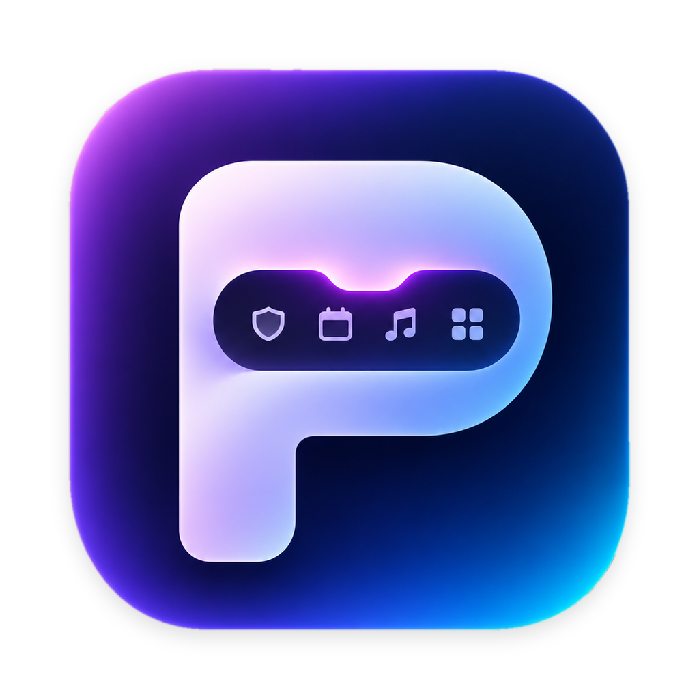
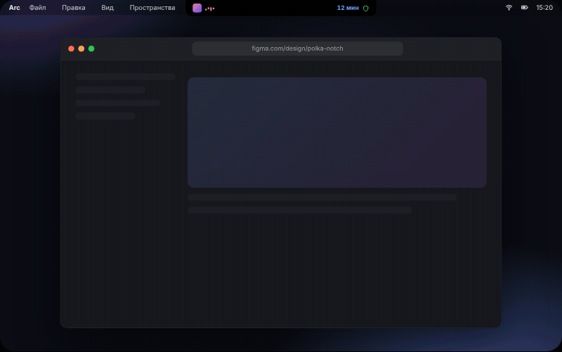

<p align="center">
  
</p>

<h1 align="center">Polka</h1>

<p align="center">
  <b>Чёлка MacBook, которая наконец полезна.</b><br>
  Вкладки из любого браузера, ваши VPN, музыка, календарь, переводчик, буфер и полка для файлов — на расстоянии одного движения мыши.<br>
  Бесплатно и с открытым кодом.
</p>

<p align="center">
  <a href="https://github.com/romabmstu/polka/releases/latest/download/Polka.dmg"><b>Скачать для macOS</b></a>
  &nbsp;·&nbsp; <a href="#установка">Homebrew</a>
  &nbsp;·&nbsp; <a href="https://romabmstu.github.io/polka/">Сайт</a>
  &nbsp;·&nbsp; <a href="README.md">English</a>
</p>

<p align="center">
  <a href="https://github.com/romabmstu/polka/releases/latest"></a>
  <a href="https://github.com/romabmstu/polka/releases"></a>
  <a href="https://github.com/romabmstu/polka/actions/workflows/ci.yml"></a>
  
  <a href="LICENSE"></a>
</p>

<p align="center">
  
  <br><sub>Анимация <a href="https://romabmstu.github.io/polka/">интерактивного демо</a> с сайта.</sub>
</p>

---

Наведите курсор на чёлку — она раскроется в панель. Уведите — спрячется обратно. На мониторах без чёлки Polka — тонкая капсула в центре строки меню, и она переходит на тот дисплей, где сейчас курсор.

В закрытом виде чёлка показывает самое важное: что играет, щит, когда включён VPN, и обратный отсчёт перед встречей.

## Почему Polka

- **Бесплатно, лицензия MIT, без аккаунта.** Ни подписки, ни платной версии, ни телеметрии.
- **То, что вы переключаете весь день, а не только музыка.** VPN-клиенты, группы вкладок из любого браузера, календарь со входом во встречу в один клик, переводчик — рядом с музыкой и буфером.
- **Приватность по умолчанию.** Всё остаётся на вашем Mac, перевод работает на устройстве. В сеть Polka ходит только за обновлениями и, если включить, за курсами валют.
- **Работает с любым дисплеем.** Чёлка на MacBook, компактная капсула на внешних мониторах.
- **Обновляется сама.** Подписанные обновления ставятся прямо из приложения.

## Что умеет

**Вкладки.** Сохраняйте страницы в группы и вложенные группы. Текущую вкладку или окно Safari, Chrome, Arc, Brave, Edge и Яндекс Браузера можно сохранить через <kbd>⌥⇧S</kbd>. Чтобы добавить адрес вручную, выберите группу и нажмите «Добавить ссылку» или «Вставить ссылку»; поддерживаются списки ссылок, Markdown и экспорт OneTab. Перетаскивайте группу за значок слева: край другой строки меняет порядок, середина вкладывает группу внутрь. Есть поиск по сохранённым страницам и сортировка ссылок.

**VPN.** Polka показывает поддерживаемые системные VPN-подключения, конфигурации Tunnelblick и FSNT Client / Throne через локальный API. В настройках Polka откройте вкладку FSNT и введите порт и ключ включённого API; ключ сохраняется в Связке ключей. В некоторых версиях FSNT API доступен только в расширенном режиме. Для приложений без поддерживаемой интеграции состояние подключения может быть недоступно. Подключениями можно управлять независимо; совместимость одновременной работы зависит от клиентов и маршрутов.

**Музыка.** Название, исполнитель, обложка и перематываемая полоса для того, что сейчас играет — Яндекс Музыка, Музыка, Spotify, видео в браузере, — и видно, какое приложение воспроизводит звук.

**Переводчик.** Перевод текста на macOS 15 и новее с помощью системного переводчика Apple. Языковые пакеты может потребоваться загрузить в Системных настройках.

**Календарь.** События на сегодня из календарей, уже подключённых к Mac (Google, iCloud, Exchange), и кнопка входа для ссылок Google Meet, Zoom, Teams, Телемоста, Jitsi и Webex.

**Калькулятор и валюты.** Пишете `1250 × 1,2 + 15%` — сразу видите ответ. Пересчёт между избранными валютами.

**Буфер.** 30 последних скопированных фрагментов, включая скриншоты и картинки. Данные, помеченные приложением как конфиденциальные или временные, пропускаются. Не все приложения помечают пароли, поэтому они могут попасть в историю.

**Полка для файлов.** Бросьте файлы в чёлку и заберите позже или отправьте по AirDrop.

**Сценарии.** Один клик на несколько действий, например «Работа»: закрыть мессенджеры, подключить VPN, включить тёмную тему, задать громкость, открыть рабочие вкладки и приложения, включить музыку. Режимы фокусирования переключаются через быструю команду.

## Установка

**Homebrew** (рекомендуем — больше ничего делать не нужно):

```sh
brew tap romabmstu/polka https://github.com/romabmstu/polka
brew install --cask romabmstu/polka/polka
```

**Образ диска:**

1. Скачайте [**Polka.dmg**](https://github.com/romabmstu/polka/releases/latest/download/Polka.dmg) и перетащите Polka в «Программы».
2. Polka пока не нотаризована Apple, поэтому macOS блокирует первый запуск скачанной копии. Один раз выполните в Терминале:
   ```sh
   xattr -dr com.apple.quarantine /Applications/Polka.app
   ```
   или откройте приложение, затем в Системных настройках › «Конфиденциальность и безопасность» нажмите **«Всё равно открыть»**.
3. Наведите курсор на чёлку или нажмите <kbd>⌥⇧K</kbd>.

Нужна macOS 14 Sonoma или новее на Apple silicon или Intel; для переводчика — macOS 15. Хотите каждую новую сборку сразу после проверки? Берите её из [бета-релиза](https://github.com/romabmstu/polka/releases/tag/nightly) или переключите канал в «Настройках» › «Обновления».

Релизные сборки сопровождаются [аттестацией происхождения](https://github.com/romabmstu/polka/attestations):

```sh
gh attestation verify Polka.dmg --repo romabmstu/polka
```

## Вопросы

<details>
<summary><b>Это безопасно? Зачем команда в Терминале?</b></summary>

Нотаризация Apple требует платного аккаунта разработчика, которого у бесплатного проекта пока нет, поэтому macOS просит подтвердить первый запуск. Взамен всё открыто: код здесь, каждую сборку делает GitHub Actions из этого репозитория, релизы сопровождаются аттестацией происхождения, а обновления перед установкой проверяются ключом Ed25519, встроенным в приложение. Polka работает с Hardened Runtime и не отправляет аналитику. Подробнее — в [SECURITY.md](SECURITY.md).
</details>

<details>
<summary><b>Зачем ей разрешения?</b></summary>

Каждое запрашивается только при первом использовании функции: управление браузером — чтобы прочитать адрес открытой вкладки, «Календари» — для событий, «Универсальный доступ» — чтобы переводить выделенный текст по <kbd>⌥⇧T</kbd>. Полный список — в [PRIVACY.md](PRIVACY.md).
</details>

<details>
<summary><b>Какие VPN-клиенты поддерживаются?</b></summary>

Всё, что есть в Системных настройках › VPN (Happ, V2Box, WireGuard, L2TP и другие), конфигурации Tunnelblick и FSNT Client / Throne через его локальный API. Для других клиентов статус может быть неизвестен.
</details>

<details>
<summary><b>Работает без чёлки?</b></summary>

Да. На внешних мониторах и Mac без чёлки это небольшая капсула в строке меню, которая открывает ту же панель.
</details>

<details>
<summary><b>Как удалить?</b></summary>

`brew uninstall --zap --cask romabmstu/polka/polka` или закройте Polka, перенесите её в Корзину и удалите `~/Library/Application Support/Polka`.
</details>

## Обновления

Polka проверяет обновления: откройте «Настройки» › «Обновления» › «Проверить» или кнопку «Обновить» в панели, затем выберите установку с перезапуском. Выберите **«Каждая новая сборка (бета)»**, чтобы получать успешно опубликованные сборки (проверка по умолчанию каждые 15 минут), или **«Релизы»** — только помеченные версии. Перед заменой обновление проверяется по ключу подписи, встроенному в приложение. Если у бета-сборки нет подписанного файла обновления, скачайте и установите её вручную со страницы сборки.

## Клавиши

| Сочетание | Действие |
| --- | --- |
| <kbd>⌥⇧K</kbd> | Открыть или закрыть Polka |
| <kbd>⌥⇧S</kbd> | Сохранить текущую вкладку браузера с выбором группы |
| <kbd>⌥⇧T</kbd> | Перевести выделенный текст |
| <kbd>⌘1</kbd> … <kbd>⌘9</kbd> | Переключить раздел |
| <kbd>⌘V</kbd> | Вставить ссылки в открытую группу |
| <kbd>Esc</kbd> | Закрыть панель |

## Приватность

В Polka нет аккаунта, аналитики и телеметрии. Вкладки хранятся локально: `~/Library/Application Support/Polka/library.json`. Перед записью Polka сохраняет предыдущие версии в соседней папке `Recovery`; для защиты от потери диска нужна отдельная резервная копия.

Сеть используется для проверки обновлений и, если включить конвертацию, получения курсов валют. Подробности и список разрешений — в [PRIVACY.md](PRIVACY.md).

## Планы

Идеи, а не обещания — голосуйте и предлагайте в [Discussions](https://github.com/romabmstu/polka/discussions):

- Нотаризованные сборки, чтобы не нужен был шаг в Терминале
- Больше интеграций с VPN-клиентами
- DeepL как дополнительный движок переводчика
- Свои разделы через «Быстрые команды»

## Сборка из исходников

Нужны macOS 14 или новее, Xcode 16 или новее и [XcodeGen](https://github.com/yonaskolb/XcodeGen).

```sh
git clone https://github.com/romabmstu/polka.git
cd polka
brew install xcodegen
make project      # создаёт Polka.xcodeproj
open Polka.xcodeproj
```

Сборки подписываются для локального запуска, аккаунт разработчика Apple не нужен. `make test` запускает тесты.

## Участие

Сообщения об ошибках и pull request’ы приветствуются, см. [CONTRIBUTING.md](CONTRIBUTING.md). Об уязвимостях, пожалуйста, сообщайте приватно, как описано в [SECURITY.md](SECURITY.md).

## Поддержать

Polka бесплатна и такой останется — без рекламы, подписок и платных версий. Если она экономит вам пару минут в день и хочется сказать спасибо, можно угостить автора кофе:

| Валюта | Сеть | Адрес |
| --- | --- | --- |
| USDT | Tron (TRC-20) | `TNxyTAuSRBcLpCbfTURjDiJHdhFjQHwBnd` |
| USDT | Ethereum (ERC-20) | `0xf080C9113c0D2Ba28b1cF23adbbEc7Aafe907D35` |
| Bitcoin | Bitcoin | `bc1q6exu9tgl2d29z9t3eczksjj4e4jrqwnd7zt22l` |

> [!IMPORTANT]
> Отправляйте только в той сети, что указана рядом с адресом. Монеты, отправленные в другой сети, вернуть невозможно.

Нет криптовалюты? ⭐ на GitHub, сообщение об ошибке или рассказ другу помогают не меньше.

## Лицензия

[MIT](LICENSE)
